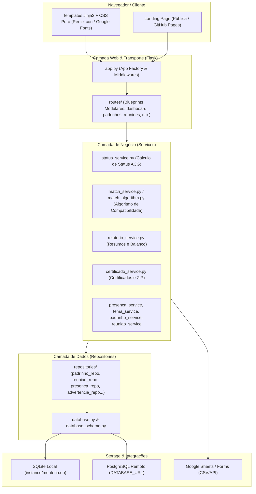
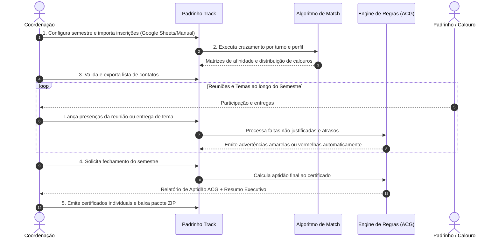
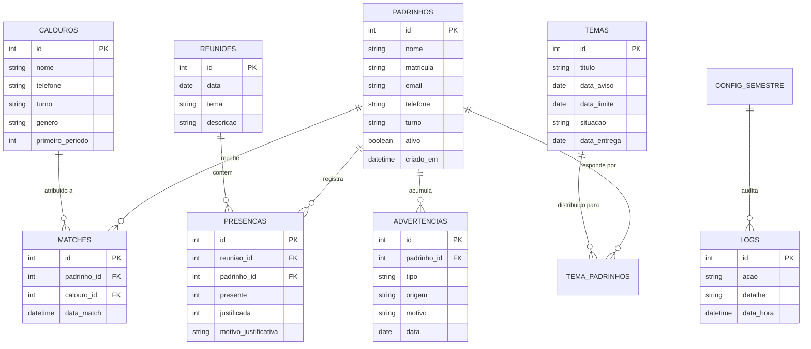

# Arquitetura do Sistema — Padrinho Track

Documento descritivo da arquitetura, fluxo de processos e modelagem de dados do **Padrinho Track**.

---

## 1. Visão Geral

O **Padrinho Track** adota uma arquitetura modular em camadas sobre **Python 3 / Flask**, separando estritamente a interface web, as rotas de transporte (Blueprints), a lógica de domínio do programa de apadrinhamento (Services) e a persistência de dados (Repositories).

---

## 2. Ciclo de Vida Semestral (Fluxo do Programa)

O ciclo de vida da mentoria é automatizado de ponta a ponta:

---

## 3. Modelo de Entidades e Relacionamentos (ERD)

A base de dados suporta tanto **SQLite** (ambiente de desenvolvimento) quanto **PostgreSQL** (produção via `DATABASE_URL`).

---

## 4. Estrutura de Diretórios e Responsabilidades

| Diretório / Arquivo | Responsabilidade |
|---|---|
| `app.py` | Fábrica de aplicação Flask, registro de Blueprints, filtros Jinja2 e controle de sessão global |
| `database.py` | Camada de conexão compatível com SQLite e PostgreSQL (com pools de conexão seguros) |
| `database_schema.py` | Definição de tabelas, índices e rotinas de migração de schema |
| `routes/` | Controladores HTTP desacoplados por módulo (dashboard, padrinhos, reunioes, match, etc.) |
| `services/` | Regras de negócio puras (cálculo de status ACG, algoritmo de match, geração de PDF) |
| `repositories/` | Consultas SQL isoladas por entidade, prevenindo SQL Injection e abstraindo queries |
| `integrations/` | Importadores e sincronizadores de Google Sheets e formulários externos |
| `templates/` | Templates Jinja divididos em `pages/` (telas completas) e `components/` (modais e cards) |
| `static/` | Folhas de estilo (`css/`), identidade visual (`brand/`) e screenshots (`capturas/`) |
| `scripts/` | Script estático do GitHub Pages (`build_site.py`), seeds de exemplo e utilitários |
| `tests/` | Suíte de testes concisa cobrindo regras de negócio, algoritmo de match e segurança de rotas |

---

## 5. Publicação Estática no GitHub Pages

Embora a aplicação de gestão seja dinâmica (Flask + banco de dados), a **Landing Page** de apresentação do programa de mentoria é construída automaticamente para o GitHub Pages através do script `scripts/build_site.py` e da action `.github/workflows/pages.yml`:

- Gera `docs/site/index.html` renderizando `templates/pages/landing.html` com caminhos estáticos.
- Copia os assets otimizados de `static/` (marcas, capturas, estilos).
- Publica no endereço: **`https://christiano-gonara.github.io/padrinho-track/`**.
