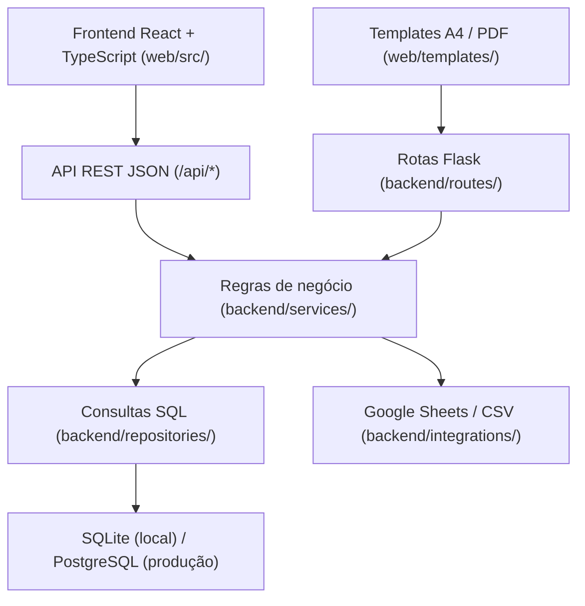

# Arquitetura do Sistema — Padrinho Track

Resumo de como o projeto está dividido entre interface (`web/`), servidor (`backend/`) e publicação estática no GitHub Pages.

---

## 1. Visão geral em camadas

---

## 2. Onde fica cada parte

| Pasta / Arquivo | O que faz |
|---|---|
| `app.py` | Ponto de entrada leve para iniciar o servidor (`gunicorn app:app`) |
| `backend/app.py` | Configura o Flask, registra as rotas e protege o acesso com login |
| `backend/routes/api.py` | Endpoints REST em JSON consumidos pelo frontend React + TypeScript |
| `backend/services/` | Regras de ACG, algoritmo de match, resumo do semestre e geração de PDFs/ZIP |
| `backend/repositories/` | Consultas SQL separadas por entidade (compatível com SQLite e PostgreSQL) |
| `backend/integrations/` | Leitura e sincronização de planilhas do Google Forms/Sheets e CSV |
| `web/src/` | Interface em React + TypeScript + Vite, com CSS separado e cenários de uso |
| `web/templates/` | Templates HTML A4 usados para imprimir relatórios e gerar certificados em PDF |
| `scripts/build_site.py` | Junta o build React com os exemplos A4 em `docs/site/` para o GitHub Pages |
| `tests/` | Testes automatizados com `pytest` para regras de ACG, match, rotas e API |

---

## 3. Como funciona o GitHub Pages

O GitHub Pages hospeda arquivos estáticos, então `scripts/build_site.py`:

1. Copia o build de `web/dist/` (React + TypeScript em tema claro, com os 3 cenários de uso clicáveis).
2. Renderiza exemplos reais em A4 (`relatorio-aptidao.html`, `resumo-semestre.html` e `certificado.html`) dentro de `docs/site/exemplos/`.
3. Publica automaticamente a cada push na branch `main` via `.github/workflows/pages.yml`.
