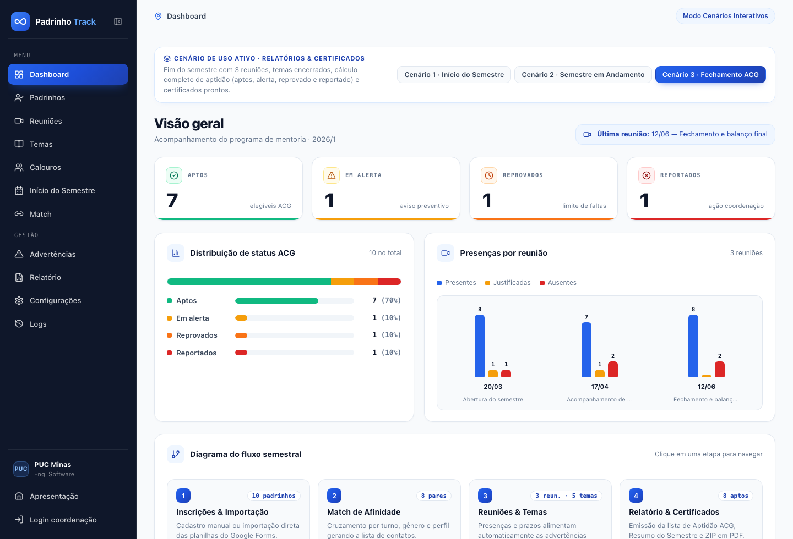
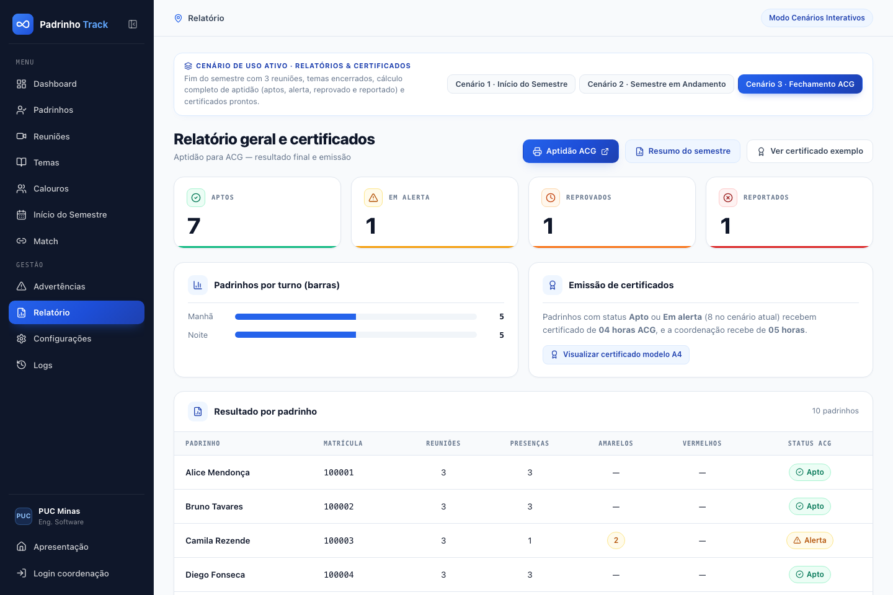
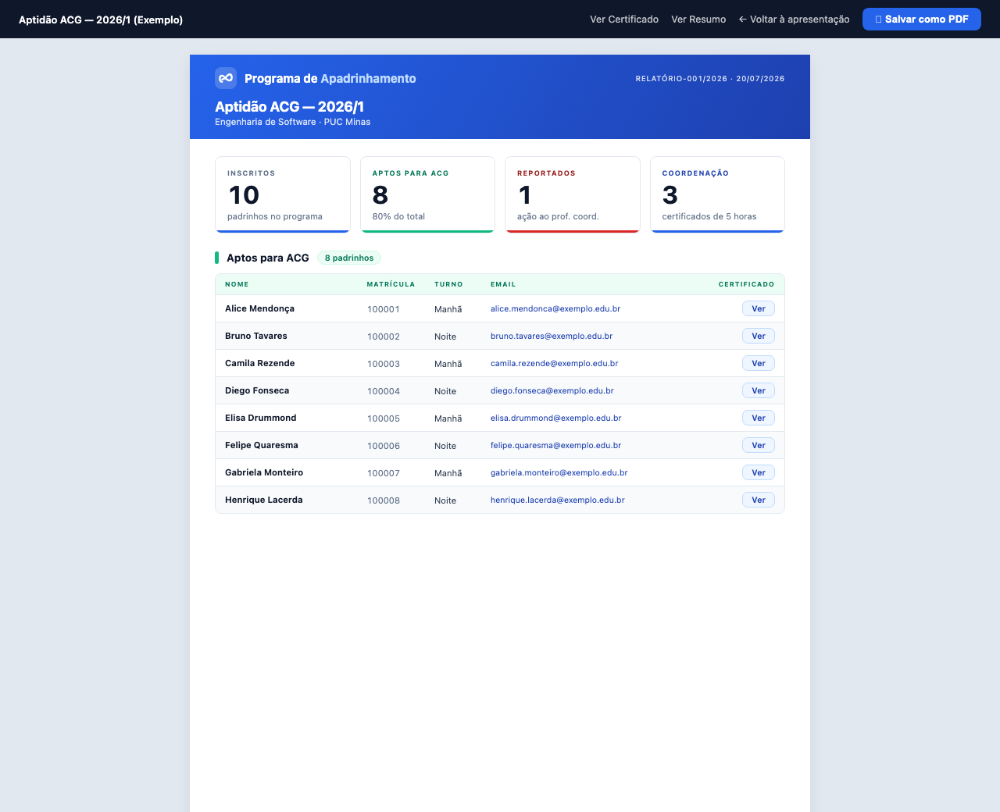
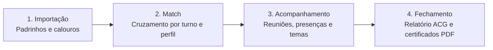

# Padrinho Track

<div align="center">


**Gestão do Programa de Apadrinhamento de Calouros**  
*Engenharia de Software — PUC Minas*

[](https://www.python.org/)
[](https://flask.palletsprojects.com/)
[](https://react.dev/)
[](https://www.postgresql.org/)
[](https://christiano-gonara.github.io/padrinho-track/)

[Ver demonstração online](https://christiano-gonara.github.io/padrinho-track/) · [Arquitetura](docs/arquitetura.md) · [Guia de transição](docs/HANDOFF.md) · [Próximos passos](docs/tarefas.md)

</div>

---

## O que o sistema resolve

Coordenar o apadrinhamento em planilhas separadas dá trabalho e gera erro na hora de fechar o semestre. O **Padrinho Track** junta todo o processo em um só lugar:

- **Cadastro e match**: importa padrinhos e calouros (do Google Forms ou manual) e sugere os pares por turno e perfil.
- **Reuniões e presenças**: registra quem foi, quem justificou e quem faltou (manual, CSV ou Google Sheets).
- **Temas e prazos**: acompanha quem ficou responsável por cada tema e se entregou no prazo.
- **Regras de ACG automáticas**: calcula quem está apto, em alerta ou reprovado sem conferência manual.
- **Relatórios e certificados**: gera o Relatório de Aptidão ACG, o Resumo do Semestre e todos os certificados em PDF (com download em ZIP).

---

## Capturas do sistema

### Apresentação e cenários de uso (GitHub Pages)


### Dashboard com gráficos em barras e diagrama do semestre


### Relatório geral e emissão de certificados


### Modelos em A4 prontos para impressão e PDF
| Relatório de Aptidão ACG | Certificado de Participação |
|---|---|
|  |  |

---

## Como o semestre funciona



| Situação do padrinho | Efeito no status ACG |
|---|---|
| Dentro do limite de faltas e sem ocorrência grave | **Apto para ACG** (certificado de 04h) |
| Chegou a 1 falta do limite (aviso preventivo) | **Em alerta** (ainda apto, com aviso) |
| Faltou em todas as reuniões sem justificativa | **Reprovado** (sem certificado) |
| Não entregou tema ou recebeu advertência vermelha | **Reportado ao professor coordenador** |

---

## Organização das pastas

```text
padrinho-track/
├── app.py              # Ponto de entrada do servidor (gunicorn app:app)
├── backend/            # API REST, regras de negócio e acesso ao banco
│   ├── app.py          # Montagem do Flask e autenticação
│   ├── database.py     # Conexão SQLite (local) / PostgreSQL (produção)
│   ├── routes/         # Rotas HTML de impressão e API JSON (/api/*)
│   ├── services/       # Regras de ACG, match, relatórios e certificados
│   ├── repositories/   # Consultas SQL isoladas por entidade
│   └── integrations/   # Leitura de planilhas Google Sheets e CSV
├── web/                # Interface React + TypeScript e templates A4
│   ├── src/            # Páginas, gráficos em barras, cenários de uso e CSS separado
│   ├── public/         # Logotipo e imagens estáticas
│   ├── templates/      # Templates A4 para PDF/impressão (relatórios e certificado)
│   └── static/         # Estilos e imagens para impressão A4
├── scripts/            # Build do GitHub Pages (build_site.py), seed e handoff
├── docs/               # Documentação e capturas de tela
└── tests/              # Testes automatizados com pytest
```

---

## Como rodar localmente

### 1. Backend (Python / Flask)

```bash
git clone https://github.com/christiano-gonara/padrinho-track.git
cd padrinho-track

python3 -m venv .venv
source .venv/bin/activate
pip install -r requirements.txt

cp .env.example .env
python app.py
```

Variáveis mínimas no `.env`:
```env
APP_USERNAME=admin
APP_PASSWORD=sua_senha_aqui
SECRET_KEY=uma_chave_segura
```

### 2. Frontend (React + TypeScript)

```bash
cd web
npm install
npm run dev
```

Acesse `http://localhost:5173` para usar o frontend React com proxy para a API Flask (`http://localhost:5000`).

### 3. Testes e build do GitHub Pages

```bash
# Testes automatizados (regras de ACG, match, rotas e API)
pytest -v

# Gerar site estático completo em docs/site/
npm run build --prefix web -- --mode pages
python scripts/build_site.py
```

---

Desenvolvido por **Christiano Gonçalves** — Engenharia de Software, PUC Minas.
